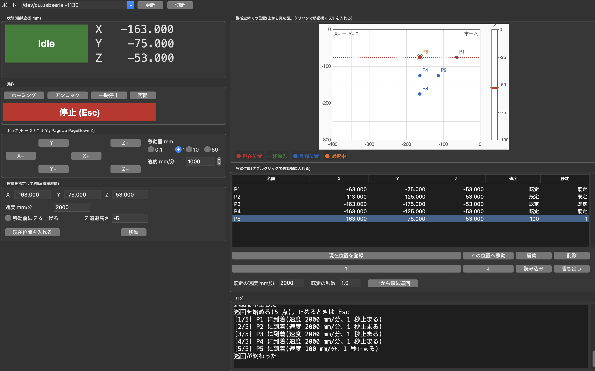

# Python から XYZ ステージとして使う

UGS を使わずに、Python から USB シリアル経由で GRBL を直接動かす。この機械は **XYZ ステージ** として使う(スピンドルは回さない)。普段は GUI で操作する。



登録した 5 点を巡回し終えたところ(2026-10-17、実機)。P5 だけ速度を 100 mm/分にしてあり、ほかの点は既定の 2000 mm/分で回っている(ログを参照)。

コードの構成やライブラリとしての使い方は [python/README.md](python/README.md) にある。

## 1. 準備(最初の 1 回)

GUI に tkinter を使うので、**tkinter が入った Python** で venv を作る。uv が入れる Python には入っている。PlatformIO や Homebrew の Python には入っていないことがある。

```sh
cd python
uv venv --python 3.12 .venv
source .venv/bin/activate        # Windows は .venv\Scripts\activate
uv pip install -e ".[dev]"
```

tkinter が入っているかは `python -c "import tkinter"` で確かめられる。

## 2. GUI を起動する

```sh
cd python
source .venv/bin/activate
python scripts/gui.py            # または genmitsu-gui
```

- **UGS は切断しておく**(ポートを使えるのは 1 つのソフトだけ)
- ポートは CH340 を自動で探す(Mac は `/dev/cu.usbserial-…`、Windows は `COM3` など)。見つからなければ一覧から選ぶ
- ウィンドウの大きさは自由に変えられる。図はウィンドウに合わせて拡大・縮小し、図・登録位置・ログの境目はドラッグで動かせる。画面が小さくて左側が収まらないときは、左側をスクロールする

## 3. 使い方

1. **接続**:「接続」を押す。接続すると GRBL がリセットされて Alarm になる
2. **ホーミング**:「ホーミング」を押す。終わるまでは図と状態の欄に「ホーミングしてください」と出て、図に現在位置は描かれない(ホーミング前の座標は意味がないため)
3. **位置を決める**:ジョグで動かすか、座標を入れて「移動」を押す。図をクリックすると、その XY が移動欄に入る(クリックだけでは動かない)
4. **登録する**:「現在位置を登録」で名前を付けて登録する。「編集…」で座標・速度・止まる秒数を変えられる
5. **巡回する**:「上から順に巡回」を押す。止めるときは **Esc**

### 画面の各部

| 場所 | 内容 |
|---|---|
| 状態 | 状態(Idle / Alarm など)と機械座標 X / Y / Z。動いている間も更新される |
| 操作 | ホーミング、アンロック、一時停止、再開、**停止**(Esc キーでも止まる) |
| ジョグ | ボタンか、キー(← → で X、↑ ↓ で Y、PageUp / PageDown で Z)。移動量は 0.1 / 1 / 10 / 50mm。前の動きが終わるまで次は受け付けない |
| 座標を指定して移動 | 機械座標を入れて移動する。既定では XYZ を同時に動かす。「移動前に Z を上げる」にチェックを入れると、Z を退避高さまで上げてから XY を動かし、最後に Z を下ろす(背の高い試料をよけたいとき)。この設定は「この位置へ移動」と巡回にも効く |
| 機械全体での位置 | 可動範囲(X 400 × Y 300mm)を上から見た図。現在位置(赤)、移動先(緑)、登録位置(青、選択中はオレンジ)を描く。右に Z のバーがある |
| 登録位置 | 一覧から移動、編集、削除、並べ替え、読み込み、書き出しができる。`~/.genmitsu/stage_points.json` に自動で保存される |
| 巡回 | 登録した位置を上から順に回る。各点へは、その点の速度で向かい、その点の秒数だけ止まる。速度・秒数が「既定」の点は、巡回欄の **既定の速度** と **既定の秒数** を使う |
| ログ | GRBL からのメッセージやエラー、巡回の進み具合 |

## 4. 座標と安全について

- 座標はすべて **機械座標**。ホーミングすれば毎回同じ位置になるので、ワーク原点(G54)を設定しなくてよい
- `$23=0` なので、ホーミングは **全軸とも + 側の端** で終わり(Z は一番上)、そこから 3mm 戻る(`$27`)。だから動ける範囲は X −400〜0 / Y −300〜0 / Z −100〜0 で、ホーミングの後は **− 方向** に動かす
- 図はホーミング位置(0, 0)を右上の角にして、X+ を右、Y+ を上に描いている
- 移動の前に、Python 側で範囲(端から 1mm 内側まで)を確かめ、外なら機械に送らない。G0 / G1 がソフトリミットにかかると `ALARM:2` になり、ホーミングからやり直しになるため(ジョグなら `error:15` で拒否されるだけ)
- **停止(Esc)** はフィードホールドの後にソフトリセットを送る。動いている途中で止めると位置が失われて Alarm になるので、ホーミングし直す
- 登録位置ごとに Z が違うと、XY と同時に Z も動く(斜めに動く)。試料に当たらないか気をつける

## 5. その他のスクリプト

`python/` で venv を有効にした状態で実行する。

| ファイル | 内容 | 機械が動くか |
|---|---|---|
| [scripts/gui.py](python/scripts/gui.py) | ステージ操作用の GUI | 動く |
| [scripts/info.py](python/scripts/info.py) | 接続確認(状態・バージョン・主な設定を表示) | 動かない |
| [scripts/terminal.py](python/scripts/terminal.py) | 対話ターミナル。G-code や `$` コマンドを 1 行ずつ送る | 送ったコマンドしだい |
| [scripts/stage_demo.py](python/scripts/stage_demo.py) | GUI を使わずに格子点を順に回る例。各点で呼ぶ `measure()` を書き換えて、測定や撮影に使う | 動く |
| [scripts/run_gcode.py](python/scripts/run_gcode.py) | G-code ファイルを送る。スピンドルの指令(`M3` / `M4`)は取り除き、送る前に範囲を確かめる | 動く |

どのスクリプトも、ポートを開くと GRBL がリセットされるので、ホーミングからやり直しになる。ワーク原点(G54)は EEPROM に保存されているので消えない。
