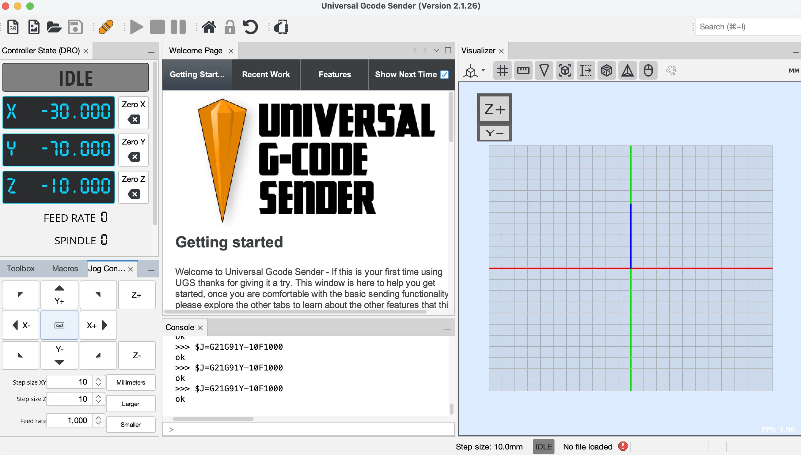

# UGS の使い方(PROVerXL 4030 V2)

Universal Gcode Sender(UGS)Platform 2.1.26 で、機械につないでテスト加工するまでの流れ。
Mac と Windows で画面は同じ。インストール手順は [SETUP_MAC.md](SETUP_MAC.md) / [SETUP_WINDOWS.md](SETUP_WINDOWS.md) を参照。

## 画面の見方

```
┌ 上のツールバー ───────────────────────────────────────────────┐
│ 📄📄📂💾  🔌 Firmware[GRBL] Port[    ] Baud[115200]  ▶ ■ ⏸  🏠 🔒 ↻ │
└───────────────────────────────────────────────────────────────┘
┌ 左上 ──────────┐┌ 中央 ───────────┐┌ 右 ──────────────┐
│ Controller State ││ Welcome Page     ││ Visualizer        │
│ (状態と座標)    ││ (閉じてよい)     ││ (加工経路の       │
├ 左下 ──────────┤├─────────────────┤│  プレビュー)      │
│ Toolbox / Macros ││ Console          ││                   │
│ / Jog Controller ││ (機械とのやり取り)││                   │
└────────────────┘└─────────────────┘└───────────────────┘
```

| 場所 | 中身 |
|---|---|
| 🔌(Firmware の左) | 接続 / 切断 |
| 📂 | G-code ファイルを開く |
| ▶ ■ ⏸ | 加工の開始 / 停止 / 一時停止 |
| 🏠 | ホーミング(原点復帰、`$H`) |
| 🔒 | ロック解除(`$X`) |
| ↻ | ソフトリセット |
| Controller State | 今の状態(`DISCONNECTED` / `Alarm` / `Idle` / `Run` など)と X/Y/Z 座標 |
| Toolbox | よく使うボタン(Reset Zero、Home Machine、Unlock など) |
| Jog Controller | 手動で軸を動かす |
| Console | 機械からの返事が出る。下の `>` 欄に `$H` などのコマンドを直接打てる |

## 1. 機械につなぐ

1. コントローラの電源を入れ、USB でつなぐ。非常停止ボタン(赤)が押されていないことを確認する
2. **Firmware**:`GRBL` を選ぶ
3. **Port**:▼を押して、次の名前のポートを選ぶ(▼を押したときに一覧が更新される)
   - Mac:`usbserial` を含むもの(例:`/dev/cu.usbserial-1130`)。`Bluetooth` などは違う
   - Windows:`COMx`(デバイスマネージャーで確認した番号)
4. **Baud**:`115200`
5. 🔌 を押す
6. Console に `Grbl 1.1h ['$' for help]` と出て、左上の状態が `DISCONNECTED` から変われば接続できている

つながらないとき:
- Port の一覧が空 → USB の挿し直し、コントローラの電源を確認する。Mac はターミナルで `ls /dev/cu.usbserial-*` を実行して出るか確認する
- 「ポートが使用中」などのエラー → Candle などほかのソフトを閉じる

## 2. アラームを解除する(ホーミング)

接続直後の状態は **`Alarm`** になる。これは異常ではなく、「まだ原点を確認していない」という意味。

1. スピンドル周りに手や物がないことを確認する
2. 🏠(または Toolbox の **Home Machine**)を押す
3. 各軸がリミットスイッチまで動いて止まる。状態が **`Idle`** になれば完了

- ホーミングがうまくいかないときは、Toolbox の **Unlock**(`$X`)で一時的にロックを解除できる。ただし原点が分からない状態なので、手で慎重に動かすこと
- 加工中に非常停止ボタンを押した後なども `Alarm` になる。ボタンを回して解除し、もう一度ホーミングする

## 3. ジョグで XYZ を動かしてみる(動作確認)

ホーミングが終わって状態が `Idle` になったら、まず手動で各軸を動かして、機械が正しく動くか確かめる。



1. 左下の **Jog Controller** タブを開く
2. 下の欄を次のように設定する

   | 欄 | 値 | 意味 |
   |---|---|---|
   | Step size XY | `10` | ボタン 1 回で X/Y が 10mm 動く |
   | Step size Z | `10` | ボタン 1 回で Z が 10mm 動く |
   | Feed rate | **`1000`** | 動く速さ(mm/分)。1000 は 1 秒に約 17mm |

   右の「Millimeters」が単位(mm)。「Larger」「Smaller」を押すと Step size が段階的に大きく / 小さくなる

3. ボタンを 1 回ずつ押して、各軸が動くか確かめる

   | ボタン | 動く軸 |
   |---|---|
   | **X+** / **X-**(左右の矢印) | X 軸 |
   | **Y+** / **Y-**(上下の矢印) | Y 軸 |
   | **Z+** / **Z-**(右端の列) | Z 軸(Z+ が上、Z- が下) |
   | 四隅の斜め矢印 | X と Y を同時に動かす |

4. 押すたびに、左上の X/Y/Z の数字が 10 ずつ変わり、Console に `$J=G21G91X10F1000` のような行と `ok` が出れば正常

注意:
- **Z- はビットが下がる方向。** テーブルや材料にぶつからないよう、ビットの下に十分な隙間があることを確認してから押す
- 端まで動かすとリミットスイッチに当たって `Alarm` になる。その場合は手順 2 のホーミングをやり直す
- 動きがおかしい、変な音がするときは、すぐにコントローラの非常停止ボタン(赤)を押す
- 中央のキーボードのアイコンを押すと、キーボードの矢印キーでもジョグできる

## 4. 材料の上に原点(加工の基準点)を決める

1. 材料をテーブルに固定し、ビット(刃)を取り付ける
2. 左下の **Jog Controller** タブを開く
3. 1 回の移動量(Step size)を選び、矢印ボタンで X/Y を動かして、材料の**左手前の角**(加工したい範囲の左下)の上にビットを持ってくる
   - 最初は 10mm など大きめで近づけ、近くなったら 1mm → 0.1mm と小さくする
   - 動きが遅いときは **Feed rate**(単位 mm/分)を上げる。初期値の 100 は 1 秒に約 1.7mm と遅い。遠くから近づけるときは 2000〜3000、材料の近くでは 300〜500 が目安(この機種の最高速度は 5000)
   - この Feed rate はジョグのときだけの速度で、加工中の速度は G-code の中の値で決まる
4. Z を少しずつ下げ、ビットの先が材料の表面にぎりぎり触れる高さで止める
   - 目安:コピー用紙 1 枚をビットと材料の間に挟み、紙が少し引っかかりながら動く程度(付属の「Make your first project.pdf」の方法)
5. 左上の **Zero X**、**Zero Y**、**Zero Z** を押す(Toolbox の **Reset Zero** で 3 軸まとめてもよい)。座標が `0.000` になる

## 5. G-code を開いて確認する

1. 📂 を押し、加工する G-code ファイルを開く
2. 右の Visualizer に加工経路が表示されるので、材料の範囲に収まっているか確認する
3. 不安なときは Toolbox の **Check Mode** を有効にして ▶ を押すと、機械を動かさずに G-code の誤りだけを確認できる。終わったら Check Mode を解除する

### 付属のテストデータ(`Test Code/`)

機械が正しく動くかを試すための、お試し加工データ。

| ファイル | 彫るもの | 使うビット | 加工範囲(幅 × 奥行) |
|---|---|---|---|
| `PROVerXL 4030V2_-Testcode_1mmDeep_Coat Engraving Bits_Elm wood.tap` | 枠付きロゴ「Genmitsu / PROVerXL 4030 V2」 | V 字の彫刻ビット | 約 100 × 37 mm |
| `Genmitsu_-Testcode_1mmDeep_Coat End mill Bits_Elm wood.tap` | 文字「Genmitsu」のみ | エンドミル | 約 100 × 16 mm |
| `*_Easel.jpg` | 上の加工データを作ったときの画面写真(作成ソフトは Easel) | — | — |
| `PROVerXL 4030 V2.dxf` | ロゴの元の図形データ。CAM ソフトで加工データを作り直すときに使う(UGS では開かない) | — | — |

- どちらの加工データも深さ 1mm(ファイル名では想定の材料がニレ材、画面写真では MDF 200 × 100 × 4 mm、ビット 1/32 インチ)
- 最初の 1 回は、文字だけの小さい方(End mill 版)が手軽
- 原点(手順 4)から右奥の方向に加工するので、材料はそれより大きいものを使う

## 6. 加工する

1. 保護メガネをかけ、集じんや換気の準備をする
2. ▶ を押すと加工が始まる(スピンドルは G-code の指示で自動的に回る)
3. 止めたいとき
   - ⏸:一時停止(もう一度 ▶ で再開)
   - ■:停止
   - **危ないときは迷わずコントローラの非常停止ボタン(赤)を押す**
4. 終わったら、ビットが上がってスピンドルが止まったことを確認してから材料を取り外す

## よくある表示

| 表示 | 意味 | 対処 |
|---|---|---|
| `DISCONNECTED` | 接続していない | 手順 1 |
| `Alarm` | 原点が未確認、またはリミットスイッチ・非常停止が働いた | 手順 2(ホーミング) |
| `Idle` | 待機中。操作できる | — |
| `Run` | 加工中・移動中 | — |
| `Hold` | 一時停止中 | ▶ で再開 |
| `[MSG:Check Limits]` | リミットスイッチが押されたままになっている | Unlock してから、ジョグでスイッチから離す |
| `error:15` | 動ける範囲(X 400 / Y 300 / Z 100mm)を超えるジョグを、ソフトリミットが拒否した。機械は動いていない | 反対方向に動かす。ホーミング直後に Z+ を押すとこれが出る |
| `ALARM:1` | 移動中にリミットスイッチが働いた(ハードリミット)。スイッチから離れる瞬間の接点のバタつきでも出る | Unlock(またはホーミング)し直す |

## GRBL の設定(2026-10-17 時点)

Console に `$$` と打つと一覧が出る。主なもの:

| 設定 | 値 | 意味 |
|---|---|---|
| `$20` | 1 | ソフトリミット有効(2026-10-17 に 0 から変更)。ホーミング後、動ける範囲を超える動きを動く前に拒否する |
| `$21` | 1 | ハードリミット有効。リミットスイッチに当たると即停止して `ALARM:1` |
| `$22` | 1 | ホーミング有効。電源を入れた直後は `Alarm` になり、ホーミングが必要 |
| `$27` | 3.000 | ホーミング後にスイッチから戻る距離(mm) |
| `$110`〜`$112` | 5000 | X / Y / Z の最高速度(mm/分) |
| `$130`〜`$132` | 400 / 300 / 100 | X / Y / Z の動ける範囲(mm) |

ソフトリミットを無効に戻すときは `$20=0` を送る。

## トラブル事例:Z の数字は変わるのに、Z が動かない(2026-10-17)

**症状**
- Jog で Z を押すと、左上の Z の数字と Console の `ok` は出るのに、機械の Z は動かない
- 起動するたびに `[MSG:Check Limits]` が出て、すぐ `Alarm` になる
- **Z モーターだけ、ランプが赤く点滅している**

**原因**
1. ホーミングの直後(Z はもう一番上)に **Z+ を押した**ため、Z が上端に押し付けられた
2. この機種のモーターは、ドライバが内蔵された閉ループ式。指令どおりに動けなかったため、**モーター側が保護停止**した(赤い点滅)。この状態では命令を受け付けないが、GRBL は気付かずに数字だけ進める
3. Z が上端のリミットスイッチを押したまま止まっていた

**直し方**
1. コントローラの電源を切り、10 秒ほど待って入れ直す → Z モーターのランプが正常に戻る
2. UGS で Unlock → Jog で Step size Z を 5、Feed rate を 300 にして **Z-** を押す。スイッチが離れるまで 1 回ずつ繰り返す(今回は 5mm 下げてもまだ少し押されていて、もう 5mm 必要だった)
3. スイッチが離れる瞬間に `ALARM:1` が出ることがあるが、問題ない。接続し直してホーミングする

**再発防止**
- **ホーミングの後は Z+ を押さない**
- ソフトリミット(`$20=1`)を有効にした(2026-10-17 設定済み)。ホーミング後は、動ける範囲を超えるジョグを動く前に拒否してくれる
